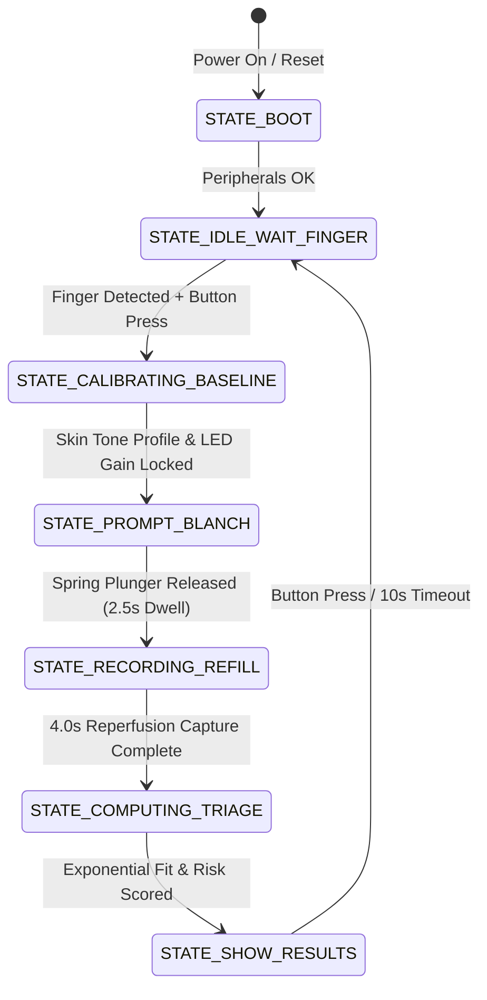

# ShockGuard – Firmware Architecture & Algorithm Specification

## 1. System Overview

The ShockGuard firmware runs on an **ESP32-S3-WROOM-1 (N16R8)** dual-core processor with 16MB Flash and 8MB Octal PSRAM. It integrates:
- High-speed **OV2640 macro camera sampling** (30+ FPS) with locked AEC/AGC/AWB.
- Synchronized **MAX30102 dual-wavelength PPG** data acquisition (100 Hz).
- Real-time **exponential regression** for Capillary Refill Time ($CRT_{90}$).
- **Multi-parameter shock triage scoring** combining CRT, Peripheral Perfusion Index (PPI), and Heart Rate.
- **SSD1306 128x64 OLED display** UI and high-speed telemetry streaming.

---

## 2. Finite State Machine (FSM)

---

## 3. Mathematical Foundations

### 3.1 Capillary Refill Exponential Decay Model
Following physical release of the spring-driven contact window, capillary reperfusion is modeled as an inverted exponential recovery:
$$y(t) = y_{base} + \Delta y \cdot e^{-\frac{t - t_0}{\tau}}$$

Where:
- $y(t)$: Optical reflectance luminance at time $t$.
- $y_{base}$: Dermal tissue baseline luminance after complete reperfusion.
- $\Delta y$: Blanching amplitude ($y_{blanched} - y_{base}$).
- $\tau$: Hemodynamic reperfusion time constant.

The standard clinical definition of Capillary Refill Time ($CRT_{90}$) corresponds to 90% blood volume return:
$$1 - e^{-\frac{CRT_{90}}{\tau}} = 0.90 \implies CRT_{90} = -\tau \ln(0.10) \approx 2.3026 \cdot \tau$$

### 3.2 Peripheral Perfusion Index (PPI)
From photoplethysmography (PPG) at 880nm (Infrared):
$$\text{PPI} = \frac{\text{AC}_{\text{IR}}}{\text{DC}_{\text{IR}}} \times 100\%$$
- $\text{AC}_{\text{IR}}$: Pulsatile arterial inflow component.
- $\text{DC}_{\text{IR}}$: Constant absorption by non-pulsatile arterial blood, venous blood, and tissue bed.

---

## 4. Multi-Parameter Triage Decision Matrix

| Parameter | Normal (Score 0) | Intermediate / Mild (Score 2) | Critical / Severe (Score 4) |
|---|---|---|---|
| **CRT ($CRT_{90}$)** | $< 2.0$ seconds | $2.0 - 3.0$ seconds | $> 3.0$ seconds |
| **Perfusion Index (PPI)** | $\ge 1.4\%$ | $0.6\% - 1.4\%$ | $< 0.6\%$ |
| **Heart Rate (HR)** | $60 - 100$ BPM | $101 - 125$ BPM (+1 score) | $> 125$ BPM or $< 45$ BPM (+2 score) |

- **Total Score 0 – 2**: `PERFUSION ADEQUATE` (Green) – Normal peripheral hemodynamics.
- **Total Score 3 – 5**: `COMPENSATED SHOCK` (Amber) – Early hypoperfusion, monitor and initiate fluids.
- **Total Score $\ge 6$** (or $CRT \ge 3.5\text{s}$, $PPI < 0.4\%$): `CRITICAL SHOCK RISK` (Red) – Severe hypovolemia or septic shock.
