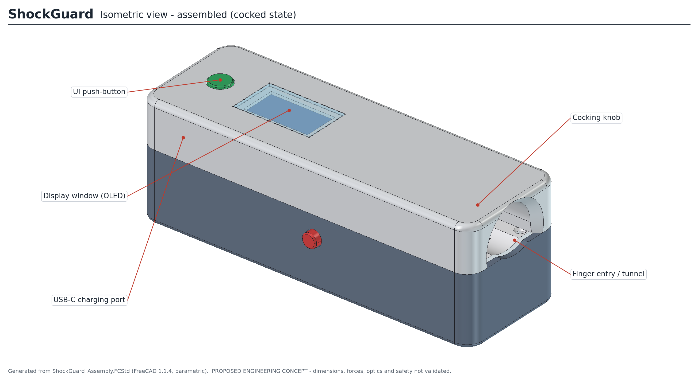
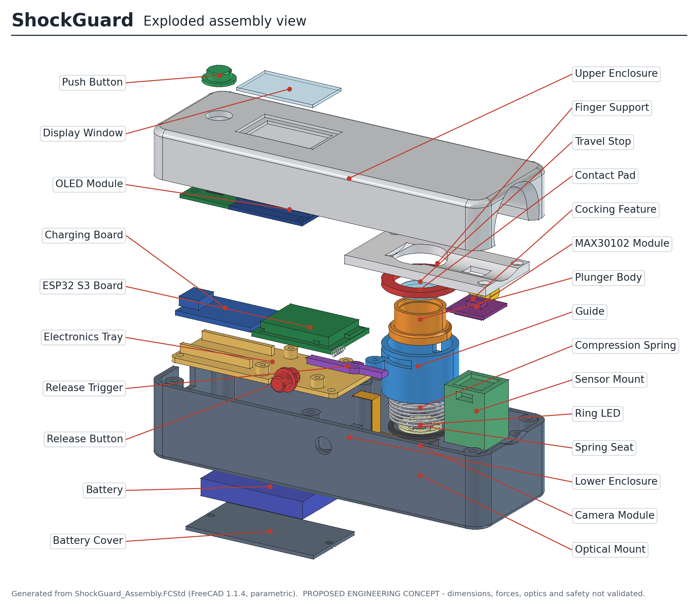
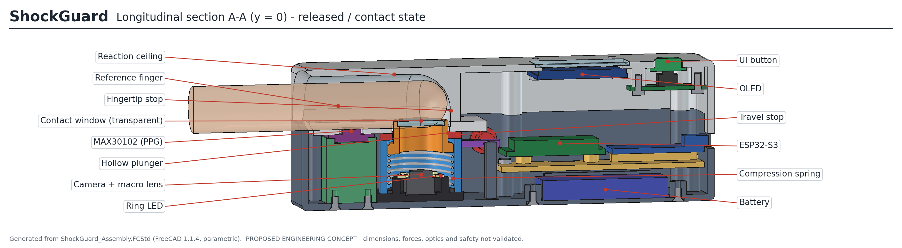
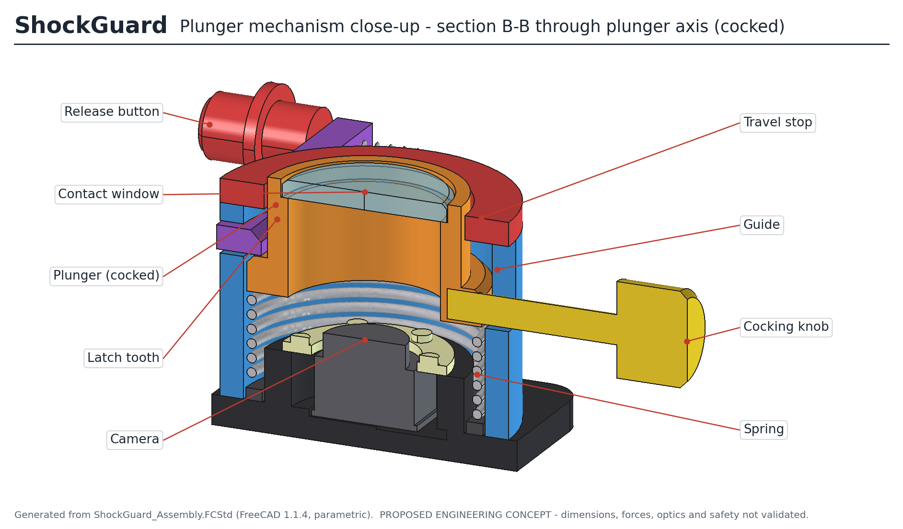
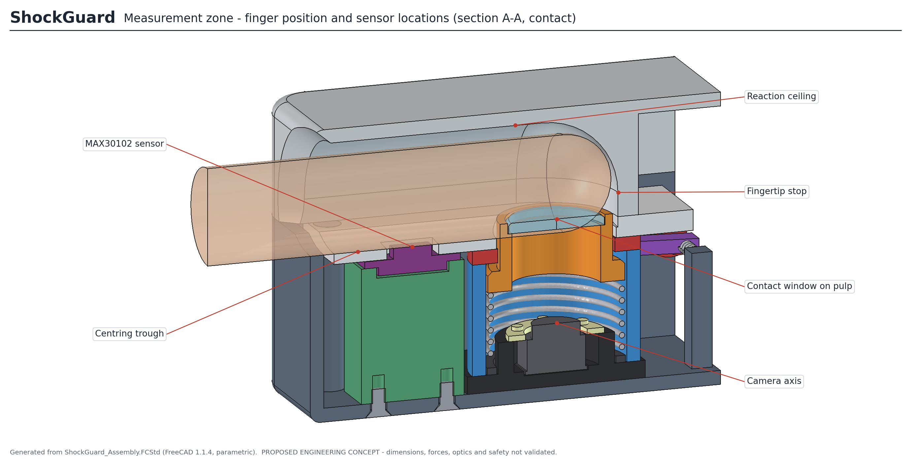
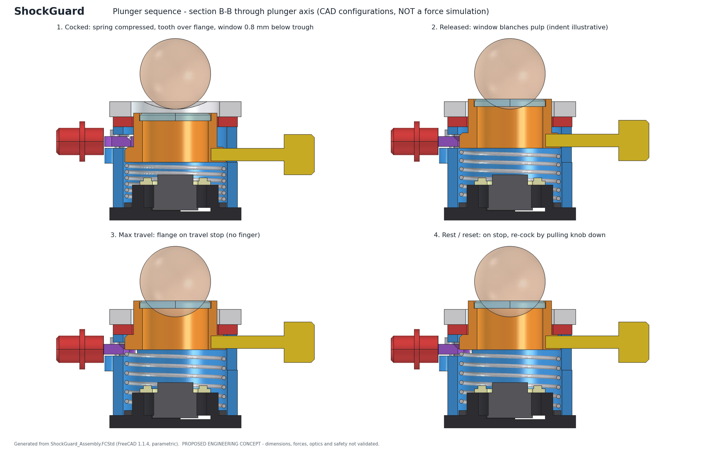

# ShockGuard – Parametric CAD Prototype

**Automated, skin-tone-calibrated capillary refill time (CRT) and Peripheral Perfusion Index (PPI) device for early shock and sepsis triage**
*Vishwakarma Awards 2026–27 · Theme 8: Frontier Diagnostics – The Next Vital Signs*

> ⚠️ **Proposed engineering concept, Rev A.** The dimensions, forces, optics and safety of this design have **not** been validated. It is not for clinical use or human testing. See [Risks](Docs/ShockGuard_Assembly_Notes.md#6-unresolved-engineering-risks-and-decisions).

ShockGuard is a fingertip clip. A **manually cocked, spring-driven plunger** presses a transparent window onto the fingertip pad. A **camera and ring LED** look through the same window to record the blanch-and-refill sequence, a **MAX30102** measures PPG, an **ESP32-S3** runs the on-device model, and an **OLED** shows the CRT, Perfusion Index and Shock Risk Score. There is no motor or servo.

This repository holds an editable, fully parametric **FreeCAD 1.1** assembly, generated by Python scripts, together with the exports, drawings, renders and verification evidence that came from it.

---

## Contents

| Path | What it is |
|---|---|
| [`CAD/ShockGuard_Assembly.FCStd`](CAD/ShockGuard_Assembly.FCStd) | Native parametric FreeCAD model: 29 PartDesign bodies plus 32 fastener links, driven by a master `Params` spreadsheet |
| [`STEP/ShockGuard_Assembly.step`](STEP/ShockGuard_Assembly.step) | Full assembly (61 solids, hierarchy preserved) |
| [`STEP/components/`](STEP/components) | 29 part STEPs and 4 screw STEPs |
| [`STL/printable/`](STL/printable) | 15 FDM-printable parts, re-oriented and placed at the bed origin |
| [`STL/ShockGuard_Assembly.stl`](STL/ShockGuard_Assembly.stl) | Visualisation mesh of the whole assembly |
| [`Drawings/ShockGuard_Engineering_Drawings.pdf`](Drawings/ShockGuard_Engineering_Drawings.pdf) | 7 A3 engineering sheets ([PNG previews](Drawings/sheet_previews)) |
| [`Renders/`](Renders) | 12 annotated views rendered from the CAD geometry |
| [`Docs/`](Docs) | Design notes, verification summary, regeneration guide, parameter table, BOM, machine-readable report |
| [`scripts/`](scripts) | Source automation: build → verify/export → render → annotate → drawings |

## Design at a glance

| | |
|---|---|
| Housing envelope | **125 × 42 × 42 mm** (overall 125 × 51 × 42.8 mm including knob and buttons) |
| Finger interface | Palm-down along −X into a 22 × 16 mm U-tunnel; domed fingertip stop; R14 centring trough |
| Compression | Hollow plunger (Ø16.5 OD, Ø13 optical bore), 4 mm stroke, Ø20 compression spring, adjustable travel stop |
| Cocking / release | Pull the side knob down to cock (latch tooth snaps over the flange); a mechanical release button on the opposite side fires it |
| Optics | Camera, ring LED and contact window on one axis; lens to skin 13 mm (macro lens required) |
| PPG | MAX30102 flush in the trough, 21 mm proximal to the plunger axis |
| Electronics | ESP32-S3-WROOM-1 carrier and USB-C charger on a removable tray; battery behind a floor door |
| Construction | Split FDM shell (PETG/ASA), 6 × M2 × 30 from below; 32 M2 fasteners in total |

| Exploded | Longitudinal section |
|---|---|
|  |  |

| Plunger mechanism | Measurement zone |
|---|---|
|  |  |

## Verification summary

CAD-level checks only (details: [`Docs/VERIFICATION.md`](Docs/VERIFICATION.md)):

- ✅ 61/61 valid solids · 17/17 sketches fully constrained
- ✅ 0 unintended interferences in all 4 mechanism states
- ✅ The latch blocks the plunger when cocked, and the travel stop blocks over-travel
- ✅ Camera view cone unobstructed · LEDs inside the bore · PPG face flush (0.00 mm)
- ✅ All 11 service and assembly removal paths clear
- ✅ 13/13 design-rule checks pass
- ✅ Parameter-propagation test passes, and reverting restores volumes exactly (Δ = 0 mm³)
- ✅ STEP re-imports as 61/61 solids; every printable STL is a closed manifold solid
- ❌ **Not done:** force, FEA, impact, optical, thermal or RF analysis; no spring rate, force or pressure assigned

## Editing the design

1. Open `CAD/ShockGuard_Assembly.FCStd` in FreeCAD 1.1 or later.
2. Change any value in column B of the **`Params`** spreadsheet, for example `overall_length`, `finger_opening_width`, `plunger_travel` or `ppg_mount_position`.
3. Press **Recompute**. Every dependent feature, placement and fastener updates.
4. Set `state` to switch the mechanism configuration (1 = rest, 2 = cocked, 3 = released/contact, 4 = max travel), or set `explode = 1` for the exploded view.

To rebuild the whole package from source, see [`Docs/REGENERATING.md`](Docs/REGENERATING.md).

## Documentation

- [`Docs/ShockGuard_Assembly_Notes.md`](Docs/ShockGuard_Assembly_Notes.md) – design intent, model structure, assembly sequence, component references, risks
- [`Docs/VERIFICATION.md`](Docs/VERIFICATION.md) – every check, its method and its result
- [`Docs/REGENERATING.md`](Docs/REGENERATING.md) – toolchain and pipeline
- [`Docs/ShockGuard_Parameters.csv`](Docs/ShockGuard_Parameters.csv) – all parameters, each tagged ASSUMED / VERIFY / PLACEHOLDER / DERIVED
- [`Docs/ShockGuard_BOM.csv`](Docs/ShockGuard_BOM.csv) – bill of materials

## Status and limitations

Every dimension is an assumption or a placeholder; the reference proposal gives no dimensions. Component envelopes (ESP32 carrier, camera, OLED, charger, battery) must be replaced with the selected vendors' drawings. A fixed spring stroke does **not** guarantee a fixed force across fingers. Force, impact, dwell time, optics, biocompatibility and regulatory classification (CDSCO) are all unresolved. A complete CAD model does not mean the device is ready for production or safe for medical use.
